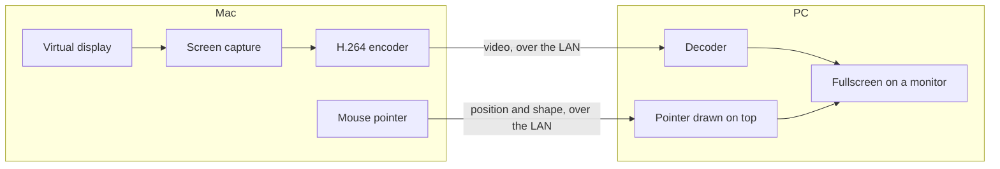

# Paneport

**More extended displays for your Mac, using another computer's monitors.**

Base Apple silicon Macs (M1 to M5) support at most two external displays, and docks can't
get around that without DisplayLink hardware and drivers. Paneport adds more displays in
software: the Mac creates virtual displays that behave like real monitors, and streams each
one over your local network to a PC, which shows it fullscreen on a monitor plugged into it.

- **Real extended displays:** arrange them, drag windows onto them, use them like any monitor.
- **Low delay:** under 10 ms measured on wired Ethernet, with the mouse pointer drawn on the
  PC in a few milliseconds.
- **Nothing to buy:** no adapter, dongle or dummy plug.
- **Two ways to view:** a browser page with nothing to install, or a Windows app with even
  less delay.

> **Status:** early and experimental. Paneport relies on an undocumented macOS feature, so a
> macOS update could break it. See [Limitations](#limitations).

## How it works



The pointer travels separately from the video, so it moves without waiting for frames.

## What you need

- **A Mac** with macOS 13 or later.
- **A PC** with Windows 10 or 11 for the Windows app, or any computer with Microsoft Edge or
  Google Chrome for the browser page.
- **A network** connecting both. Wired Ethernet gives the lowest delay.

## Install on the Mac

**From a release:** download `Paneport-…-mac.zip` from the Releases page, unzip it and move
Paneport to Applications. Releases aren't signed by Apple yet, so the first time,
right-click the app and choose **Open**.

**From source:** install the Xcode Command Line Tools (`xcode-select --install`), then:

```sh
git clone <repository URL> paneport
cd paneport
./make-app.sh
open build/Paneport.app
```

The first time you press **Start Streaming**, macOS asks for Screen Recording permission.
Allow it, then quit Paneport from its menu bar icon and open it again.

## Set up

1. **Configure the displays.** On the **Displays** tab, add one virtual display per PC
   monitor and set its resolution to match that monitor.
2. **Press Start Streaming.**
3. **Connect the PC** with the Windows app or a browser (below).
4. **Arrange the displays.** On the **Arrangement** tab, drag the new displays to where the
   monitors sit on your desk.

### On the PC: Windows app (recommended)

Open the address shown on Paneport's **Connect** tab in Edge or Chrome on the PC and click
**Get the Paneport app for Windows**. Run it, enter the same address, and choose which
monitor shows which display. It remembers your choices, reopens the screens by itself and
updates itself from the Mac. Press **Esc** on a Paneport screen to quit.
More in [windows/README.md](windows/README.md).

### On the PC: browser

1. Open the address shown on the **Connect** tab in Edge or Chrome.
2. Save the page once (**Ctrl+S**, "Webpage, HTML Only") and open the saved file from then
   on. Browsers only allow video decoding on local pages; the saved page still loads the
   latest version from the Mac each time.
3. Put a browser window on each monitor and click the display it should show.

Press **S** on a streamed screen to show the delay overlay. The same figures appear in the
Mac app.

## Settings

| Setting | Tab | What it does |
|---|---|---|
| Resolution | Displays | Match the PC monitor's native resolution for the sharpest picture. |
| Retina (HiDPI) | Displays | Double sharpness; the desktop looks like half the resolution. For 1440p and 4K monitors. |
| Refresh rate | Displays | Use 120 Hz if the PC monitor supports it: it lowers delay. |
| Quality | Displays | Video bitrate. About 20 Mbit/s suits 1080p; use more for 1440p, 4K and Retina. |
| Arrangement | Arrangement | Where each virtual display sits; they snap edge to edge. |
| Mouse pointer | Connect | Drawn on the PC (fastest, the default) or inside the video. |
| Hide pointer while typing | Connect | Hides the pointer while you type, like macOS. |
| Port | Connect | The address's port; each display streams on the next ports up. |

Settings save automatically. Changes that need the displays restarted show an
**Apply Changes** button.

## Tips

- Use wired Ethernet on both computers.
- Plug the PC monitors into the same graphics card. In the browser, set Edge or Chrome to
  use that card (Windows Settings > System > Display > Graphics); the Windows app picks the
  right card by itself.
- Choose 120 Hz on the Displays tab if your PC monitors support it.

## Troubleshooting

| Problem | What to do |
|---|---|
| "macOS is blocking screen capture" | In System Settings > Privacy & Security > Screen & System Audio Recording, remove old Paneport entries, add Paneport from Applications, then quit and reopen it. If that fails, run `tccutil reset ScreenCapture local.paneport` and try again. |
| Black screen in the browser | Reload the page, or open the Mac's address and save the page again. The status text in the bottom-left corner says what's wrong. |
| High delay with several browser screens | The overlay's first line should say "worker". If it says "main thread", please report your browser and version. |
| The Windows app can't connect | Check the address on the Connect tab, that Paneport is streaming, and that the Mac's firewall allows incoming connections for Paneport. |

## Limitations

- **Undocumented macOS feature:** virtual displays use Apple's private `CGVirtualDisplay`
  API, so an update could break them, and the app can't be on the Mac App Store.
- **No encryption or password:** anyone on your network who knows the address can watch the
  streams. Use Paneport only on networks you trust.
- **Colour detail:** the video uses 4:2:0 colour, so small coloured text is slightly softer
  than on a cabled monitor.
- **Pointer drawn on the PC:** some apps' custom pointers appear as the standard arrow, and
  windows you drag trail the pointer slightly.
- **Retina:** depends on macOS offering a HiDPI mode for the display; if it doesn't, Paneport
  says so and uses standard resolution.

## Contributing

Bug reports, measurements from different setups and pull requests are welcome. See
[CONTRIBUTING.md](CONTRIBUTING.md) to build and test the three parts (the Mac app, the
browser page and the Windows app), and [docs/ARCHITECTURE.md](docs/ARCHITECTURE.md) and
[docs/PROTOCOL.md](docs/PROTOCOL.md) for how they work.

## Supporting the project

Paneport is free. If it saves you buying an adapter, please consider sponsoring its
development.
<!-- Add sponsor and donation links here, and in .github/FUNDING.yml. -->

## License

Paneport is free software under the [GNU General Public License v3.0](LICENSE). You may use,
study, change and share it; if you distribute a changed version, it must be under the same
license with its source code available.
