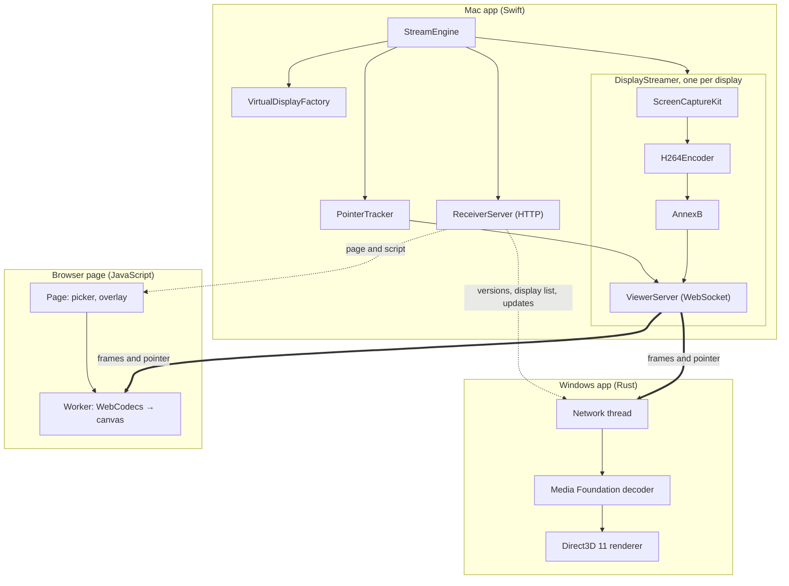

# Architecture

Paneport has three parts that share one [wire protocol](PROTOCOL.md):

- **The Mac app** (Swift): creates the virtual displays, captures and encodes them, and
  serves everything the PC needs.
- **The browser page** (HTML and JavaScript): a viewer that needs no installation.
- **The Windows app** (Rust): a native viewer with less delay.

## Source layout

| Path | Contents |
|---|---|
| `Sources/CVirtualDisplay` | Header declaring Apple's private `CGVirtualDisplay` classes. |
| `Sources/Paneport/App` | Entry point, the SwiftUI `App`, and `AppInfo` (name, identifiers, links). |
| `Sources/Paneport/Model` | Settings (`AppSettings`, `DisplayConfig`), presets, live status types. |
| `Sources/Paneport/Engine` | `StreamEngine`: starts and stops everything and publishes state to the UI. |
| `Sources/Paneport/Display` | Creating virtual displays, listing screens, arrangement and snapping. |
| `Sources/Paneport/Streaming` | Capture, encoding, Annex B conversion, the wire protocol, the WebSocket server. |
| `Sources/Paneport/Pointer` | Sending the pointer separately: tracking, shape capture, pure maths. |
| `Sources/Paneport/Web` | HTTP server, served files, network addresses. |
| `Sources/Paneport/Support` | Logging, the host clock, user-facing errors. |
| `Sources/Paneport/UI` | SwiftUI views: the settings window, its tabs, the menu bar menu. |
| `Sources/Paneport/Resources/receiver` | The browser page: `index.html`, `protocol.js`, `receiver.js`. |
| `windows` | The Windows app; see [windows/README.md](../windows/README.md). |
| `Tests` | Swift unit tests and the browser page's Node tests. |

## The Mac app

### Lifecycle

1. **Start** (`StreamEngine.start`): checks Screen Recording permission. For each enabled
   display it creates a virtual display and a `DisplayStreamer`, switches Retina displays to
   their HiDPI mode, starts the `ReceiverServer` on the base port and each streamer on the
   next ports up, then starts the `PointerTracker` if the PC draws the pointer.
2. **Streaming:** ScreenCaptureKit delivers a frame only when the screen changes. Each one is
   encoded by VideoToolbox, converted to Annex B, given a 17-byte timing header and sent to
   every viewer of that display.
3. **Stop:** tears everything down. Releasing the `CGVirtualDisplay` objects removes the
   displays.

### Threading

| Type | Runs on |
|---|---|
| `StreamEngine`, all UI | Main actor |
| `PointerTracker` | Main thread (AppKit event monitors and `NSCursor`) |
| `DisplayStreamer` and its `ViewerServer` | The streamer's serial queue; public methods hop onto it |
| `ReceiverServer` | Its own serial queue; it only reads immutable data |

## The viewers

**Browser page:** browsers only allow video decoding (WebCodecs) on secure or local pages,
so the user saves the page once. The saved page fetches the current script from the Mac on
every open, so updates need no re-save. Each window decodes in its own background worker
and draws to an `OffscreenCanvas`, with the pointer on a second, transparent canvas.

**Windows app:** per display, a network thread feeds a Media Foundation decoder thread,
which feeds a Direct3D 11 render thread. Pointer updates skip the decoder. Each window
renders on the graphics card its monitor is connected to, and presents with tearing allowed,
without waiting for the monitor's refresh.

## Design decisions

- **Frames only on change, then refine.** A still screen sends nothing. Once it stops
  changing, the last image is re-encoded a few times so it sharpens to full quality.
- **Keyframes on demand.** Sent when a viewer joins or falls behind, not on a timer, which
  keeps the bitrate low. A viewer more than a few frames behind skips to the next keyframe
  instead of building up delay.
- **A worker per browser window.** Windows of one browser share a main thread; decoding in a
  worker per window removed a 60–80 ms penalty with two screens.
- **The pointer drawn on the PC.** The Mac forwards every mouse movement as it happens
  (`NSEvent` monitors) and the viewer draws the pointer on its own layer, so it never waits
  for video. Typing detection uses `CGEventSource` idle times. Neither needs extra
  permissions.
- **Measured, not guessed.** Frames carry capture and send times on the Mac's clock. Viewers
  sync their clock with ping and pong, using the fastest round trip, and report each stage's
  delay back to the Mac every second.
- **One release for all parts.** The Windows app is bundled inside the Mac app and downloaded
  from it, so a PC always gets the version that matches its Mac.

## Extending

- **A new setting:** add it to `AppSettings` or `DisplayConfig` with a default and decode it
  with `decodeIfPresent`, so older saved settings still load. Decide in
  `requiresRestart(comparedTo:)` whether it needs the displays restarted, then add the control.
- **A new message:** document it in [PROTOCOL.md](PROTOCOL.md), implement it in
  `WireProtocol.swift`, `protocol.js` and `protocol.rs` with tests, and raise the protocol
  version if older viewers would break.
