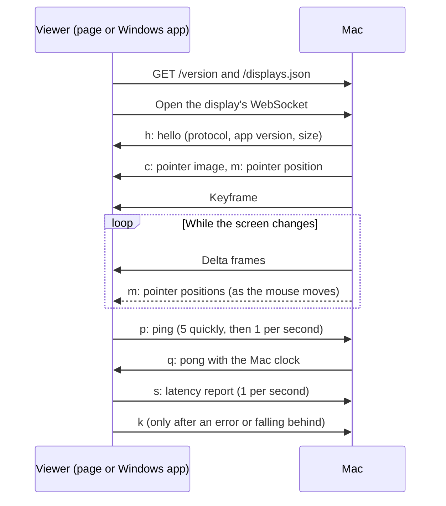

# Wire protocol

Viewers talk to the Mac over plain HTTP and one WebSocket per display. The three
implementations, which must stay in step:

| Side | File |
|---|---|
| Mac | `Sources/Paneport/Streaming/WireProtocol.swift` |
| Browser page | `Sources/Paneport/Resources/receiver/protocol.js` |
| Windows app | `windows/src/protocol.rs` |

## A connection



## HTTP (base port, default 8080)

| Path | Response |
|---|---|
| `/` | The viewer page, with the host the browser used and the display list filled in. |
| `/receiver.js` | The current page script (`protocol.js` followed by `receiver.js`). Saved pages load it on every open. |
| `/displays.json` | `[{"name": "Left", "port": 8081, "width": 1920, "height": 1080}, …]` |
| `/version` | `{"app": "0.4.0", "protocol": 1, "windowsReceiver": {"version": "0.1.0", "path": "/download/windows"}}`. `windowsReceiver` is left out when the build doesn't include the Windows app. |
| `/download/windows` | The Windows app (`PaneportReceiver.exe`), or 404. |

Every response allows any origin, because saved pages run from `file://`.

## WebSocket (one per display: base port + 1, + 2, …)

### Mac → viewer, binary: video frames

| Offset | Size | Field |
|---|---|---|
| 0 | 1 | 1 for a keyframe, 0 for a delta frame |
| 1 | 8 | Capture time: µs on the Mac's host clock, big-endian |
| 9 | 8 | Send time: µs on the Mac's host clock, big-endian |
| 17 | rest | H.264 in Annex B form; keyframes start with the SPS and PPS |

Viewers derive the decoder's codec string (`avc1.PPCCLL`) from the first keyframe's SPS.

### Mac → viewer, text

| Message | Meaning |
|---|---|
| `h:<json>` | Sent first on every connection: `{"protocol": 1, "app": "0.4.0", "name": "Left", "width": 1920, "height": 1080}`. Viewers check `protocol` and set up their decoder from the size. |
| `q:<echo>:<mac µs>` | Reply to a ping: the viewer's own timestamp, then the Mac's clock. |
| `m:<x>,<y>,<visible>,<mac µs>` | Pointer position in stream pixels (one decimal place), `1` or `0` for visible, and when it was read. |
| `c:<json>` | Pointer image: `{"png": "<base64>", "w", "h", "hx", "hy"}`; size and hot spot in stream pixels. |

Pointer messages are sent only when the PC draws the pointer. A display the pointer leaves
gets one message with `visible` set to `0`, then nothing until the pointer returns. Viewers
that connect later receive the current image and position straight away.

### Viewer → Mac, text

| Message | Meaning |
|---|---|
| `p:<viewer ms>` | Clock-sync ping. |
| `k` | Request a keyframe, after a decoder error or after dropping frames to catch up. |
| `s:<json>` | The last second's latency figures, in milliseconds. Field names match `LatencyStats`: `total`, `encode`, `network`, `decode`, `browser`, `pointer`, `rtt`, `fps`, `mbps`, `drops`; any may be `null`. |

### Clock sync

For each pong received at local time `t1`, where `t0` is the echoed ping time:

```
rtt    = t1 − t0
offset = mac_ms − (t0 + rtt / 2)
```

Viewers use the offset from the sample with the shortest round trip among the last 20, as
it is the least affected by queueing.

## Versioning

The protocol version (`WireProtocol.version`, `VERSION` in protocol.js, `PROTOCOL_VERSION` in
protocol.rs) is raised whenever a change would break existing viewers. Adding a message
that older viewers can ignore doesn't need a new version. A Node test checks that the Mac
and the page agree.

- **Browser page:** it loads its script from the Mac, so it normally matches. A mismatch
  means a stale copy, and the page asks to be reloaded or saved again.
- **Windows app:** it checks `/version` when it starts. When the Mac offers a newer version
  of the app it updates itself from `/download/windows`: automatically if the protocol
  differs, after asking otherwise.
- **Saved pages:** the page's markup (element IDs, the loader script) must stay compatible,
  because saved copies keep their old markup and only load the new script.
