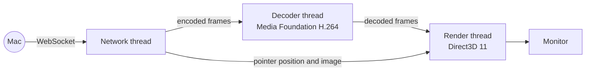

# Paneport Receiver for Windows

A native alternative to the browser page: it shows the Mac's virtual displays fullscreen on
this PC's monitors with less delay, and remembers which display goes where.

- **Lower delay:** draws straight to the screen with Direct3D 11 (flip model, tearing
  allowed), instead of waiting for a browser's next frame.
- **No page saving or window dragging:** pick the monitors once; it reopens them by itself.
- **Right graphics card:** each window renders on the card its monitor is plugged into.
- **Stays in step with the Mac:** it downloads updates from the Mac it connects to.

## Getting it

- **From the Mac:** open the Mac's address in Edge or Chrome on the PC and click
  "Get the Paneport app for Windows". (Release builds of Paneport include it.)
- **From GitHub Releases:** `PaneportReceiver.exe` on the
  [Releases page](https://github.com/SarwinR/paneport/releases).
- **Build it yourself:** see below.

Windows may warn that the app is from an unknown publisher until releases are code-signed.

## Using it

```
PaneportReceiver.exe [--host 192.168.1.20:8080] [--setup] [--vsync]
```

The first time, it asks for the Mac's address (shown on Paneport's Connect tab) and which
monitor each Mac display should use. Both are remembered in `%APPDATA%\Paneport\receiver.json`.

| Option | Meaning |
|---|---|
| `--host ADDRESS` | Use this Mac address (and remember it). |
| `--setup` | Choose monitors again. |
| `--vsync` | Wait for the monitor's refresh: no tearing, slightly more delay. |

While Paneport screens are showing, Windows won't turn the monitors off or go to sleep.
Press **Esc** on a Paneport screen to quit. The console window shows the delay every five
seconds, and the same numbers appear in the Mac app.

## Building

Install Rust from <https://rustup.rs>, then in this folder:

```
cargo build --release
target\release\PaneportReceiver.exe
```

Testing, formatting and bundling a build into the Mac app are covered in
[CONTRIBUTING.md](../CONTRIBUTING.md).

## How it works

Each display gets three threads. Pointer updates skip the decoder, so the pointer never
waits for video:



| File | Role |
|---|---|
| `main.rs` | Options, connecting to the Mac, update check. |
| `app.rs`, `setup.rs` | One borderless fullscreen window per chosen monitor (winit). |
| `session.rs` | Per display: WebSocket connection, clock sync, stats, and the render loop. |
| `decoder.rs` | H.264 with Windows' Media Foundation decoder in low-latency mode. |
| `renderer.rs` | Direct3D 11: NV12 → RGB in a shader, the pointer on top, flip-model presentation. |
| `protocol.rs` | The wire protocol and other pure logic; no Windows APIs, fully unit-tested. |
| `api.rs`, `config.rs`, `update.rs` | HTTP to the Mac, saved settings, self-update. |

## Current limits

- Decoding runs on the CPU (Windows' decoder is multi-threaded and fast at 1080p). Decoding
  straight into GPU memory (DXVA) is the next step, mainly for 4K streams.
- Setup questions are asked in the console window.
